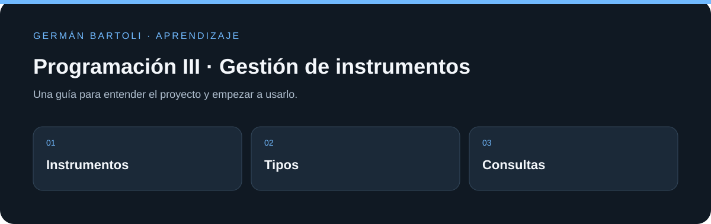

# Programación III · Gestión de instrumentos

**Trabajo práctico de ASP.NET MVC sobre instrumentos musicales, tipos y consultas a la base de datos.**

[Empezar](#primeros-pasos) · [Mapa del repositorio](#mapa-del-repositorio) · [Autoría](#autoría-de-esta-documentación)

*Esquema de orientación; no representa una captura de la aplicación.*

## Primeros pasos

1. Abrí la solución `Parcial_2_Programacion_3/Parcial_2_Programacion_3.sln` en Visual Studio con las herramientas de ASP.NET y .NET Framework 4.7.2.
2. Prepará una base local a partir de `BDParcial2.txt` y revisá `Models/GestorBD.cs` antes de conectarla.
3. Iniciá el proyecto web y recorré las acciones de `LocalController`; contrastá el comportamiento con la consigna incluida en el repositorio.

## Entorno de aprendizaje

Este repositorio conserva ejercicios y versiones de su etapa de estudio. Revisá los archivos de proyecto para preparar el SDK, runtime o servidor correspondiente; esta actualización del README no migra dependencias ni acredita una ejecución reciente de todos los ejemplos.

## Mapa del repositorio

- [Parcial_2_Programacion_3/Parcial_2_Programacion_3.sln](<Parcial_2_Programacion_3/Parcial_2_Programacion_3.sln>)
- [Parcial_2_Programacion_3/Parcial_2_Programacion_3/Parcial_2_Programacion_3.csproj](<Parcial_2_Programacion_3/Parcial_2_Programacion_3/Parcial_2_Programacion_3.csproj>)

## Autoría de esta documentación

Repositorio mantenido por [Germán Bartoli](https://github.com/GermanBartoli). Guía revisada y actualizada con **Codex**, coautor de esta actualización documental. Los autores, colaboradores, licencias y recursos de terceros conservan sus créditos originales.

Los commits de esta revisión incluyen `Co-authored-by: Codex <noreply@openai.com>`; esta atribución no modifica la autoría del historial anterior.

<!-- firma-german-bartoli -->

  <a href="https://germanbartoli.pages.dev/">
     
    Hecho por Germán Bartoli · Ver portfolio
  </a>

